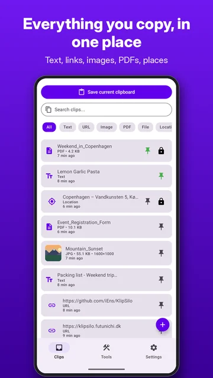
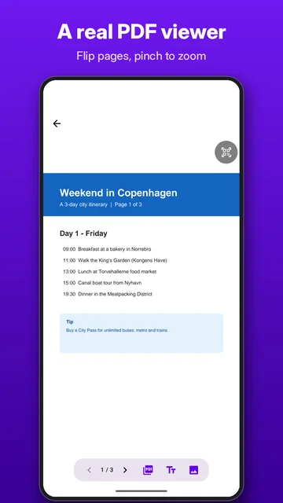
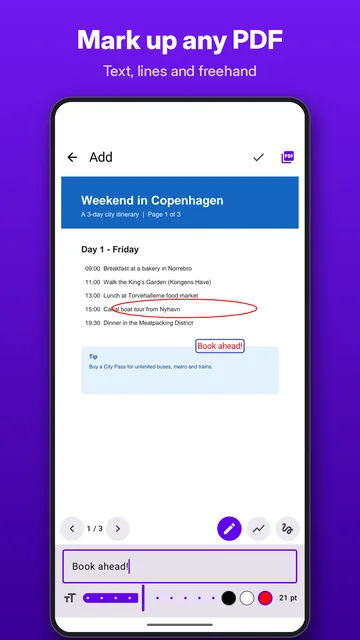
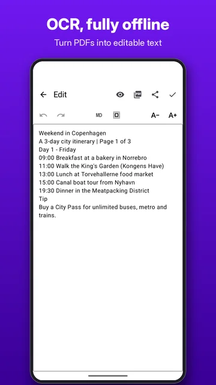
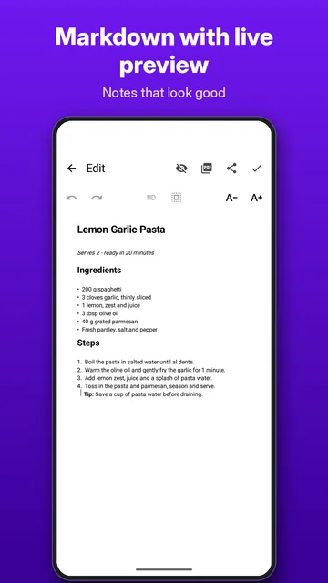
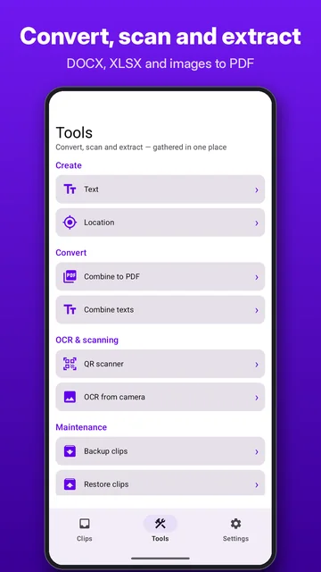
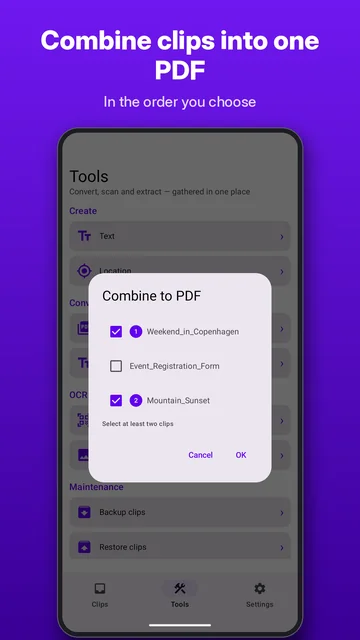
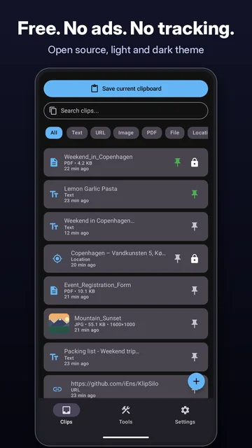

# KlipSilo

KlipSilo is a clipboard for Android. It keeps text, links, images, PDFs, files, and places on the phone. There is no account and no KlipSilo server. Nothing is saved unless you share it into the app or tap save.

<a href="https://play.google.com/store/apps/details?id=com.phaprodevelop.klipsilo"></a>

Application id: `com.phaprodevelop.klipsilo`. This tree is version 1.1.0 (versionCode 11000).

## Screenshots

<table align="center">
  <tr>
    <td></td>
    <td></td>
    <td></td>
    <td></td>
  </tr>
  <tr>
    <td></td>
    <td></td>
    <td></td>
    <td></td>
  </tr>
</table>

## Features

- Save text, URLs, images, PDFs, other files, and locations, and search them later.
- Share into the app, or save the current clipboard while the app is in front. It does not watch the clipboard in the background.
- Convert TXT, RTF, DOCX, and XLSX to PDF on the device.
- Open PDFs, zoom, decode a QR code on a page, run OCR, and save one page as its own PDF.
- Annotate a PDF with text and strokes.
- Find links and phone numbers, and open a saved place in navigation.
- English and Danish.
- Lock a clip against an accidental edit or delete. That lock is not encryption.

Conversion, viewing, OCR, and QR scanning run on the phone. Saving a location may ask the device geocoder for an address. Content leaves the app only when you share it.

## Build

- JDK 17 (source and target). The checked-in Gradle daemon toolchain requests JDK 21; JDK 21 also builds this tree.
- Android SDK 36, with build-tools 36.
- A `local.properties` file in the repo root:

```
sdk.dir=/path/to/Android/Sdk
```

`ANDROID_HOME` is an alternative when `local.properties` is absent.

```sh
./gradlew test
./gradlew :app:assembleDebug
./gradlew :app:assembleRelease
./gradlew :app:assembleBeta
```

`beta` is a second build type. Its application id is `com.phaprodevelop.klipsilo.beta`, the launcher name is "KlipSilo Beta", and the icon is orange, so it installs beside the Play app. The release build type is unchanged: application id `com.phaprodevelop.klipsilo`, versionName `1.1.0`, versionCode `11000`.

The beta version comes from a tag such as `v1.2.0-beta.1` (versionCode `11901`). `DEPLOYTOOL_ARTIFACT_REF` wins when it is set, because a deploy builds from `git archive` and that tree has no `.git`. Otherwise Gradle uses `git describe`. A checkout that is not on a beta tag falls back to `1.2.0-beta.1`. The same release keystore signs the beta APK when `DEPLOYTOOL_SIGNING_*` is set.

Debug builds are signed with the debug keystore. Release builds are signed only when these environment variables are set:

- `DEPLOYTOOL_SIGNING_STORE_FILE`
- `DEPLOYTOOL_SIGNING_STORE_PASSWORD`
- `DEPLOYTOOL_SIGNING_KEY_ALIAS`
- `DEPLOYTOOL_SIGNING_KEY_PASSWORD`

Without them, `:app:assembleRelease` produces an unsigned APK.

## Layout

The landing page, Play listing assets, and deploy config are not in this repository.

## Credits

Jørn is the main developer of the app. Jens S. maintains this open-source release and the site and deploy setup.

## License

Apache License 2.0. See [LICENSE](LICENSE) and [NOTICE](NOTICE). The bundled Liberation fonts are SIL Open Font License 1.1. Google ML Kit barcode and text recognition are under the Google ML Kit Terms of Service, which is not an OSI license.
